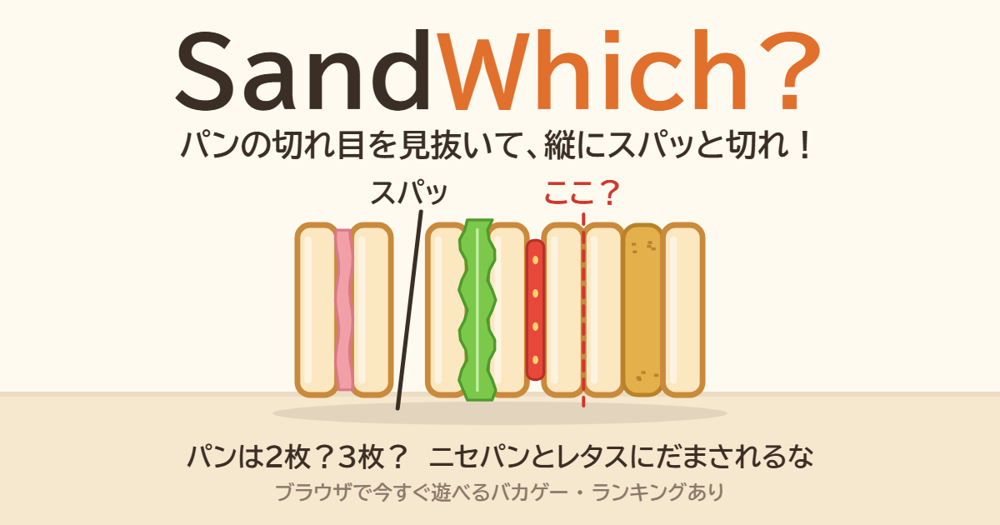

# SandWhich?

パンとパンのあいだを、縦にスパッと切るだけのゲームです。
……なんだけど、パンが2枚なのか3枚なのか、意外と見分けがつかない。

**▶ あそぶ：https://fryo52.github.io/sandwhich/**

- サンドイッチはパン2枚か3枚
- レタスの下に切れ目が隠れてることがある
- ハッシュポテトはパンじゃない

ブラウザで遊べます。スマホ推奨。
